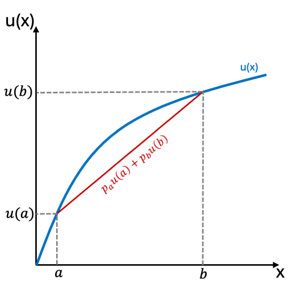
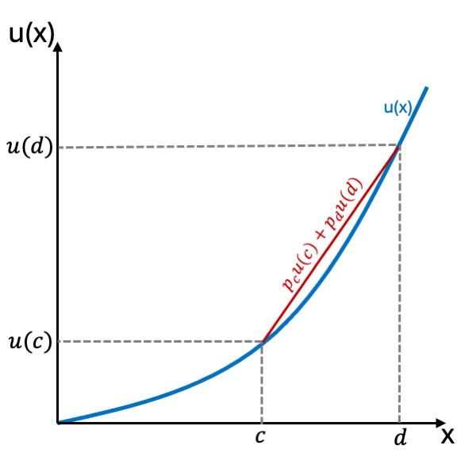
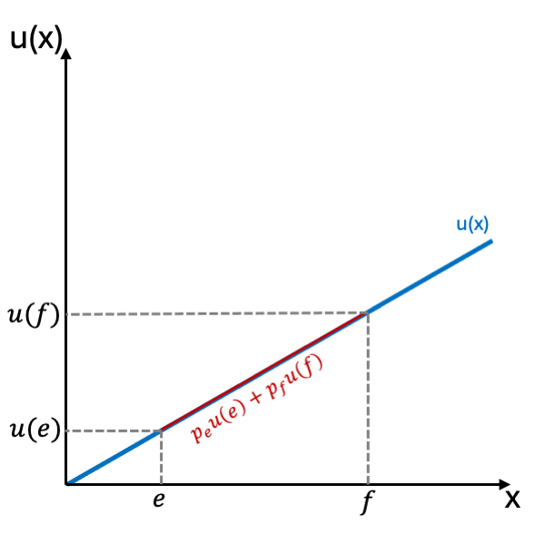
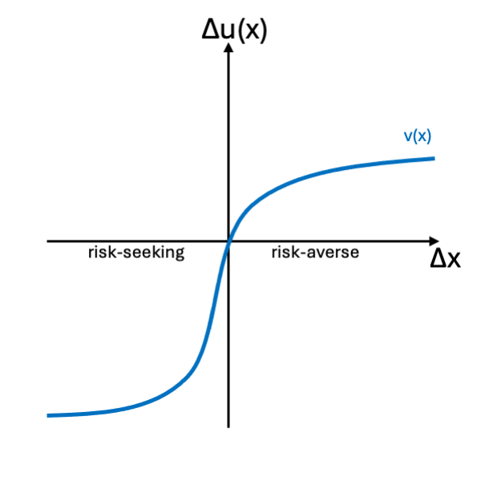
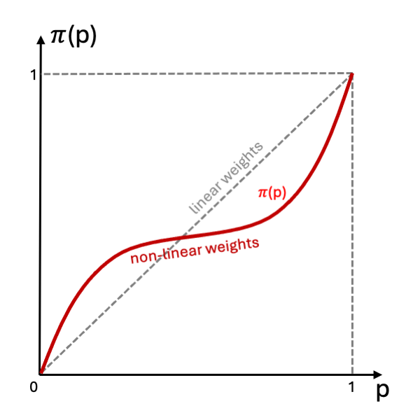
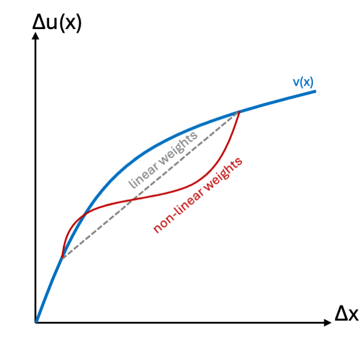

# Models in Decision-making under Risk and Uncertainty

**Author:** Martin Höppner

**Date:** 2025

## Abstract

This paper systematically compares dominant frameworks for modeling decision-making under risk and uncertainty, evaluating their theoretical trade-offs and practical relevance for economic research. We establish key criteria for model selection - including predictive accuracy, descriptive realism, computational tractability, and ecological validity - to guide researchers in matching frameworks to specific contexts. While classical axiomatic models provide normative benchmarks, our analysis highlights the need for context-sensitive models. We propose three research frontiers: (1) integrating behavioral axioms with machine learning architectures, (2) neuroeconomic validation of decision-theoretic assumptions, and (3) dynamic models for evolving uncertainty landscapes. The survey provides a structured framework for advancing decision theory while maintaining methodological pluralism in behavioral economics.

**Keywords:** Risk, uncertainty, ambiguity, expected utility theory, decision theory

**JEL classification:** D81, D03, C91

empty

## Introduction

Decisions under risk and uncertainty shape economic behavior, from everyday investments to high-stakes policy design. While risk involves known probabilities of outcomes (e.g., flipping a coin), uncertainty or ambiguity arises when probabilities or outcomes are unknown (e.g., investing in emerging technologies) [@knight1921risk]. Understanding how individuals and institutions navigate these scenarios is central to economics, where risk preferences influence market dynamics, financial stability, and welfare outcomes. Yet, modeling decision-making under these conditions remains fraught with theoretical and empirical challenges.

Risk has long been conceptualized in economics as variance in outcomes [@markowitz1952portfolio], where rational agents weigh expected rewards against statistical dispersion. This framework, however, clashes with real-world behavior: individuals often conflate risk with potential loss [@kahneman1979prospect], disregard probabilities in favor of emotional salience [@loewenstein2001risk], or avoid ambiguity altogether [@ellsberg1961risk]. These deviations underscore the limitations of classical models like Expected Utility Theory (EUT), which assume stable preferences and perfect rationality.

This paper provides a critical synthesis of decision-making models under risk and uncertainty from economics, psychology and biology, evaluating their theoretical coherence, empirical validity, and applicability to economic contexts. We begin by examining the foundations and failures of EUT (Sectioneut), which remains a normative benchmark despite facing key challenges (Sectionchall). We then analyze alternative frameworks from behavioral theories like Cumulative Prospect Theory to computational approaches like deep neural networks. In doing so, we focus on the theoretical foundations, empirical support, and practical limitations of each model, highlighting the contexts in which they best capture observed decision-making behavior (Sectionmodels). Finally, we synthesize the insights gathered to outline directions for future research (Sectionimplications), aiming to guide scholars in choosing the appropriate decision framework for specific contexts.

## Expected Utility Theory

EUT, formalized by [@von1944theory], established itself as the cornerstone of decision-making under risk by providing an axiomatic framework for modeling rational choice. At its core, it assumes that rational individuals assign a utility value $ u(\cdot) $ to each outcome $ x_i $ of a choice $ X $, weigh these by their probabilities $ p_i $, and choose the alternative that maximizes expected utility:

$$ E[u(X)] = \sum p_i \cdot u(x_i) $$

where $ u(\cdot) $ represents a utility function mapping outcomes to subjective value. Its enduring appeal lies in its axiomatic foundations: completeness (individuals can rank all prospects), transitivity (consistent preferences), independence (irrelevance of unrelated alternatives), continuity (small probability changes do not reverse preferences), and monotonicity (preference for higher rewards), which allow for empirical testing and normative evaluation of EUT [@fishburn1981subjective].

EUT’s primary strength is its normative clarity. By reducing complex decisions to a mathematical expectation, it provides a universal benchmark for rationality. Its two major features are stable individuals' preferences and their probability judgements. This simplicity enabled widespread adoption in economics, underpinning models of portfolio optimization [@markowitz1952portfolio], insurance demand, and strategic interaction in game theory [@von1944theory]. For instance, EUT rationalizes insurance purchases as a trade-off between premium costs and the utility of eliminating catastrophic losses.

A second advantage is its mathematical tractability. The concavity or convexity of $ u(\cdot) $ directly encodes risk preferences: concave functions model risk aversion, convex functions risk-seeking behavior, and linear functions risk neutrality (see Figureeu). This flexibility allows EUT to accommodate diverse individuals while retaining analytical solvability. The theory’s axiomatic structure also facilitates empirical testing, as violations of independence or transitivity reveal deviations from rationality [@schoemaker1982expected, reviewed in].

*Risk aversion*

*Risk-seeking bahavior*

*Risk neutrality*

## Challenges

Expected utility theory took off as a very compelling normative model [@savage1954foundations, see] and the most prominent normative theory to decisions under risk. However, empirical and theoretical challenges soon revealed its limitations in describing real-world behavior.

[@allais1953comportement] famously demonstrates that individuals do not evaluate known probabilities linearly. Instead, they tend to overweight certain outcomes - a tendency encapsulated in the certainty effect.[@kahneman1979prospect] illustrate this with a canonical choice: faced with{33%to win 2500, 66%to win 2400, 1%to win nothing}versus{2400 for certain}, most individuals prefer the sure gain. After rearrangement, this preference implies $ 0.33 \cdot u(2500) < 0.34 \cdot u(2400) $. Yet, when choosing between{33%to win 2500}and{34%to win 2400}directly, many individuals reverse their preference, violating EUT's independence axiom.

Additionally, individuals might lack the time, information, or computational capacity to optimize as EUT prescribes. Herbert Simon’s theory of bounded rationality posits that individuals satisfice by selecting sufficient satisfactory rather than optimal choices [@simon1955behavioral]. This framework acknowledges that decision-makers, while goal-oriented, are constrained by cognitive architecture and environmental complexity [@jones1999bounded]. For example, time pressure may prevent a decision-maker from considering all relevant information. This has led to extensive research on attention economy [@pedersen2021political, see], a procedural limitation tied to bounded rationality. Furthermore, calculations might take too long or be too costly; some calculations might even be impossible to make for an individual; and finally, some information might not be obtainable at all due to uncertainty. These constraints reflect the failure of comprehensive rationality in real-world settings, where deviations from expected utility - such as framing effects or overcooperation in political bargaining - reveal substantive limits on purely self-interested optimization [@jones1999bounded]. Bounded rationality thus reshapes how we understand preference formation, probability expectations, and decision-making processes. Its empirical critiques, spanning psychology, economics, and political science, underscore the necessity of models that account for human cognitive boundaries [@gigerenzer2002bounded; @jones1999bounded].

Uncertainty has another interesting effect on individuals' decision-making behavior, illustrating EUT's limitations. In the Ellsberg Paradox [@ellsberg1961risk], participants choose between two urns - one with known probabilities, one with unknown. EUT predicts no preference change due to ambiguity, yet empirical evidence shows individuals prefer known probabilities (risk) over ambiguity, even with equivalent expected values. Ambiguity aversion contradicts the independence axiom and is robust, but context-dependent [@machina2014ambiguity]. As noted by [@camerer1992recent], individuals may favor ambiguity in domains where they perceive themselves as experts, such as sports betting, over equivalent risky options.[@tversky1995weighing] highlight similar effects in non-monetary contexts. Other contextual effects influencing ambiguity preferences are explored in [@fox2002ambiguity].

As a consequence, individuals' subjective probability judgements are systematically skewed. One out of many examples is the availability bias, where individuals overestimate probabilities of events that happened recently, are especially easy to remember or have a major medial presence.[@slovic2013perception] show that individuals even largely neglect probabilities especially for rare events. Instead they find that subjective risk perception is highly dependent on consequence impact.

Forming stable and consistent preferences as EUT necessitates is also cognitively demanding. As such, we observe dynamic inconsistency, which refers to the phenomenon where an individual's preferences change over time in such a way that what was initially planned or preferred is no longer the choice made when the time to act arrives [@bradley2025fairness], a prominent example being procrastination. This inconsistency poses a challenge to expected utility theory, which assumes that individuals make consistent choices that maximize their expected utility over time.

One possible explanation is the earlier discussed certainty effect, as future payoffs are inherently unsure.[@andreoni2012risk] examine how risk and time are intertwined. Through controlled experiments involving intertemporal choices with manipulated risk, they find that individuals deviate from the predictions of EUT, particularly when certainty is involved.

Another possibility is that preferences, which determine risk attitudes, may not always be stable due to the cognitive cost of maintaining consistency.[@slovic1995construction; @lichtenstein2006construction] argue that preferences during the elicitation process are not revealed, but constructed. Differences in elicitation methods can lead to preference reversals [@lichtenstein1971reversals], violating the assumptions of completeness and transitivity. This is especially true for preferences formed ad-hoc or in low-stakes situations. Following this theory, preferences would not necessarily be stable and consistent. We argue that this would especially be the case for non frequently needed preferences or those with low impact on one's own well-being. For example, while an individual might have readily available and consistent preferences for its favorite foods, they might be unsure about their preferences regarding political candidates in a far away local election.

Beyond cognitive limitations, emotional and social factors profoundly affect decision-making under risk. Emotions such as fear can induce heightened risk aversion, causing individuals to overemphasize potential losses relative to gains. This fear-induced risk aversion is particularly visible in high-stakes economic environments, where uncertainty and potential negative outcomes trigger a stress response that biases decisions towards safer, more predictable outcomes [@loewenstein2001risk]. Social factors, like cultural norms or comparative performance play a significant role for individuals' preferences. Normative reasons for this behavior are to either fit in or gain comparative advantages.[@muller2019decisions] for instance examine how individuals act less risk-averse, while being ahead makes them more risk-averse, maximizing their chance for a good position within a group as a result.

Taken together, these findings suggest that the two pillars of EUT - well-defined, stable preferences and accurate probability judgments - are context-sensitive, cognitively costly, and socially contingent. Thus, there is the necessity of models that attempt to address these challenges.

## Methods of Resolution

### Modern Expected Utility Theory

One could argue that maximization with bounded rationality and uncertainty is possible if the decision process is modeled rationally. Individuals would then behave as-if maximizing expected utility [@friedman1953methodology]. The information-gathering process becomes a rational subroutine, continuing as long as the marginal return exceeds the marginal cost [@kirchgassner2008homo; @kahneman2011thinking, see for example].

[@arrow2004bounded] examined if decision-making with bounded rationality is optimal when all costs are considered. He highlights that knowing is time-consuming and costly, leading to a multi-staged problem. Arrow discusses a logical paradox in modeling bounded rationality as fully rational, suggesting it may lead to non-falsifiable models if every deviation from EUT is explained by additional constraints.

Arrow also examines decision algorithms as capital, where solving a second-order problem can aid multiple first-order problems. For example, the process of learning to drive a car is costly and time-consuming, but might still be beneficial if that helps with enough other relevant problems. However, this argument is not universal, as second-order problems may involve simultaneous optimization of multiple first-order problems. Thus, he doubts that actual problem-solving can be deduced as the optimal response to computational costs [@arrow2004bounded, p. 48]. Similarly,[@starmer2000developments] argue for alternative non EUT models. These could either relax one or more core axioms of EUT [@machina1982expected; @ozbek2024expected, for example] or drop the utility maximization completely.

Modern EUT retains relevance in contexts requiring normative benchmarks, such as actuarial risk pricing or institutional decision protocols, where consistency and tractability outweigh descriptive realism. Its axiomatic foundations provide clarity for modeling large-scale economic behaviors, such as market equilibrium under perfect information. However, in context of bounded rationality with resource constraints and uncertainty, practical models face the danger of rationalizing every deviation, leading to overfitting; or failing to account for empirically observed deviations like framing effects or probability weighting. These limitations restrict its applicability to environments with high ambiguity, time pressure, or subjective risk perceptions, where alternatives like prospect theory or heuristic models gain traction.

### Fast & Frugal Heuristics

[@gigerenzer2002bounded] argue that equating bounded rationality with rationality under constraints deviates from Simon’s original intent. They propose heuristics as an alternative problem-solving method to achieve good - rather than optimal - solutions. Heuristics are simple decision-making rules that individuals use under uncertainty or bounded rationality. Fast and frugal heuristics act as an adaptive toolbox, deliberately ignoring some available information to enhance ecological efficiency, i.e. this shifts the focus from the decision-making process to how well it fits the environment and serves the individual.

For example, this perspective suggests that emotions can serve as ecologically rational mechanisms to aid decision-making under bounded rationality [@clore2011psychology; @garces2019emotional]. For instance, curiosity may help individuals direct their attention effectively [@wojtowicz2020curiosity].

Simon emphasized that ecological limitations are inherent to decision processes, necessitating a departure from the idealized assumptions of EUT, especially the axiom of completeness. This leads to satisficing - settling for satisfactory options rather than optimizing. For instance, a consumer may choose a smartphone based on a few key attributes, like brand and price, instead of exhaustively comparing every available option.[@baumol2004rational] offers two additional arguments for satisficing. First, optimization may lead decision-makers to unfamiliar or risky options, while satisficing encourages familiarity, reducing uncertainty. Second, satisficing helps avoid transaction costs associated with radical changes that optimization may require, impacting employee morale and subcontractor relations.

[@gigerenzer2020explain] criticizes EUT as an as-if theory, asserting it describes optimal solutions without reflecting the underlying psychological processes. If individuals use heuristics to act as-if rational, it is more effective to study these heuristics directly. The as-if assumption may introduce bias, leading to less accurate predictions. Therefore, models of heuristics should delineate the sequential steps in the decision-making process directly and predict outcomes [@gigerenzer2011heuristics].

According to [@friedman1953methodology], the predictive power of a theory should be the basis for its evaluation. To assess a model's predictive ability, we must consider bias and variance. Bias refers to the accuracy of predictions on average, while variance indicates the spread of predictions. A model with no bias but high variance may yield predictions further from the true value than a model with low bias and variance.

The bias-variance trade-off is a critical aspect of statistical education in comparing complex and simple machine learning models [@yang2020rethinking]. The essential question is whether to include an additional explanatory variable in the regression model. Adding parameters may improve the model's fit to observed data, but overfitting can lead to poorer predictions out of sample. Furthermore, if explanatory variables are correlated, omitting a variable can distort the estimates of the remaining ones. In [@gigerenzer2016towards], EUT is framed in terms of overfitting, interpreting noise as causal influence. However, one must be cautious not to disregard available information for the sake of low variance, ignoring obvious causal factors. After all, while "42" (a predictor with zero variance) might be the answer to the ultimate question of life, the universe, and everything in Douglas Adams' "The Hitchhiker's Guide to the Galaxy," it is not applicable in real life. This represents another layer of optimization problems based on preferences, experiences, learning, and constraints. While the study of heuristics as problem solving methods is certainly useful, there still remains the question why and how the decision was made [@mishra2014decision].

The heuristic approach to modeling decision-making provides a framework for analyzing how agents navigate real-world constraints such as incomplete information, time pressure, and computational limitations. A key strength lies in its methodological realism: rather than assuming agents optimize exhaustively, heuristic models formalize how simple rules align with economic environments where complexity overwhelms cognitive or institutional capacities [@gigerenzer2002bounded; @simon1955behavioral]. For example, in labor markets, firms often adopt hiring heuristics (e.g., prioritizing educational credentials over nuanced skill assessments) to streamline recruitment under time constraints - a pattern better captured by heuristic models than by EUT’s optimization assumptions [@baumol2004rational]. This approach also sidesteps the tautological pitfalls of “as-if” rationalization by specifying the procedural steps agents take, rather than retrofitting deviations to utility functions [@gigerenzer2020explain]. However, heuristic models face criticism for their context-dependent validity: while they excel in explaining behaviors like habitual consumption (e.g., brand loyalty as a satisficing rule) or myopic investment choices, they struggle to generalize across environments or predict when agents will switch strategies under shifting incentives [@kahneman2000psychological]. Additionally, their emphasis on descriptive accuracy can come at the cost of predictive precision, particularly in settings requiring quantitative risk calibration.

Another perspective on heuristics comes from [@tversky1974judgment] and [@kahneman1979prospect], who view them as potential malfunctions of optimal decision-making. While heuristics can provide cost-efficient decision rules, they may also lead to biases or failures in judgment [@kahneman2000psychological]. Heuristics are broad, as developing a specific rule for each context would be inefficient. Thus, they serve as mental shortcuts that enable quick decisions but can result in systematic errors.

### Cumulative Prospect Theory

[@kahneman1979prospect; @tversky1992advances] argue instead for a kind of utility maximization with relaxed axioms in their Cumulative Prospect Theory (CPT). It describes decision-making as comprising two phases. In the editing phase, individuals simplify their available alternatives through coding, combination, segregation, and cancellation [@kahneman1979prospect; @tversky1981framing]. Coding is particularly critical, as it establishes a reference point that determines whether outcomes are perceived as gains or losses. This reference point typically derives from an individual's current status quo or biased expectations. In the subsequent evaluation phase, an option $ X $ is assessed using an evaluation function $ v(\cdot) $ and decision weights $ \pi $.

$$ u(X) = \sum \pi_i \cdot v(x_i) $$

The evaluation function exhibits diminishing marginal utility for gains and increasing marginal harm for losses, i.e. loss aversion. Consequently, the utility function is concave for gains, but convex and steeper for losses, suggesting risk-seeking behavior below the reference point and risk aversion above it. The weighting function in CPT accounts for the overvaluation of low-probability events and undervaluation of medium- to high-probability events (see Figurecpt). Note that decision weights are positive monotone transformations of objective probabilities, not direct probabilities themselves.

*Evaluation function $ v(\cdot) $*

*Weighting function $ \pi(p) $*

*Weights and risk preference*

[@kahneman2011thinking] posits that heuristics and biases reflect "mental economy," where cognition aims to minimize cognitive costs.[@gigerenzer2010if] views prospect theory as a complex as-if model, introducing additional free parameters into utility calculations. Critiques raise concerns about the vague definitions of utility and decision weights in CPT, particularly the determination of reference points [@barberis2013thirty; @mishra2014decision].[@kHoszegi2006model] advocate for reference points that are endogenously determined by an individual’s rational expectations, leading to a personal equilibrium. By contrast,[@baillon2020searching] find that the status quo or security levels often serve as reference points, rather than expectations. Similarly,[@kibris2021theory] and [@bordalo2022salience] argue that individuals often choose the most prominent alternative as a reference point. Adding further complexity,[@bernheim2020empirical] challenge CPT’s assumption that probability weighting is rank-dependent, suggesting that it may be less influential than previously thought.

However, CPT empirically accounts for many of the behavioral anomalies and biases that EUT struggles with, leading to theoretical advancements [@mcdermott2008evolutionary; @mallpress2015risk] and growing empirical support [@barberis2013thirty; @barberis2021prospect]. For example,[@ProspectTheoryandPoliticalDecisionMaking] highlight CPT’s success in modeling political decision-making but critique its selective application and ex post rationalization. Similarly, a 30-year review finds that reference points and risk perception play a significant role in shaping credit risk decisions [@ogunmokun2023prospect].

Additionally, efforts toward synthesis have emerged in the literature.[@harrison2009expected] and [@bruhin2010risk] recommend a mixture of models for predicting behavior. The latter found that about 80%of individuals acted in line with CPT, while 20%adhered to linear probability weighting consistent with EUT.

CPT provides a robust framework for modeling decision-making under risk by addressing key empirical deviations from EUT, such as loss aversion, probability weighting, and reference dependence. Its primary strength lies in its descriptive realism: by formalizing how individuals actually evaluate gains and losses relative to subjective reference points (e.g., status quo or expectations), CPT explains phenomena like the disposition effect in financial markets, where investors holding losing stocks too long and selling winners too quickly [@barberis2013thirty]. In policy design, CPT’s emphasis on framing effects has informed “nudge” interventions, such as structuring retirement savings defaults to exploit loss aversion [@kahneman2011thinking]. However, the CPT approach faces methodological trade-offs. While its S-shaped utility function and nonlinear probability weighting improve fit to observed data, they introduce complexity - critics argue that parameter proliferation (e.g., reference point variability, probability distortion curves) risks overfitting and reduces predictive generalizability [@gigerenzer2010if]. For instance, endogenous reference points in labor economics (e.g., wage negotiations tied to shifting expectations) complicate ex ante predictions of risk preferences [@kHoszegi2006model]. Despite these limitations, CPT remains influential in applied economics, particularly in finance (modeling equity premia), insurance (explaining deductible aversion), and behavioral public policy. Its hybrid use -combined with EUT in agent-based models - acknowledges that while not all agents weight probabilities nonlinearly, a majority exhibit reference-dependent behaviors [@harrison2009expected; @bruhin2010risk].

While CPT’s descriptive power is unmatched, its complexity raises questions about overfitting. Rank-Dependent Utility (RDU) offers a streamlined approach, retaining nonlinear probability weighting while simplifying assumptions about reference dependence.

### Rank-dependent Utility

Rank-dependent Utility (RDU), pioneered by [@quiggin1982theory; @schmeidler1989subjective], posits that individuals evaluate outcomes based on their relative positions among alternatives rather than their absolute values. A rank-based weighting model calculates the subjective utility of a choice, with assigned weights reflecting attention given to certain outcomes [@weber1997reasons]. For instance, investors may give greater weight to extreme gains or losses compared to median outcomes, highlighting the significance of these extremes in shaping overall utility.

A way to formalize the general model is given by [@diecidue2001intuition]. For a ranked series of outcomes $ x_1 > ... > x_n $ of a choice $ X $ and decision weights $ \pi_i = w(p_1 + ... + p_i) - w(p_1 + ... + p_{i-1}) $ for associating $ x_i $ with the best possible outcome $ x_1 $ the rank-dependent utility is given by:

$$ RDU = \sum \pi_i \cdot u(x_i) $$

RDU encompasses both EUT and CPT as special cases while also representing individuals who process probabilities non-linearly, deviating from traditional rational assessments. For example, a simple RDU model as used in [@ferro2021quantum] poses a standard concave utility function and CPT-like decision weights (much alike Figurecpt(c)). However, in general RDU utility and probability weighting functions can take a great variety of forms. They only imply that attention allocation to outcomes depends on their perceived desirability. As [@vlaev2011does] show, empirical evidence indicates a shift toward prioritizing comparisons over values as the primary determinant of choice, making RDU a prime candidate for modeling these comparisons.

Critiques of RDU models highlight their complexity, difficult testability, and debated intuition [@safra1998constant; @diecidue2001intuition, see].[@abdellaoui2002genuine] address these issues and further develop RDU by linking it to probability weighting through revealed probability trade-offs. Their findings show that relaxing the independence axiom of EUT to stochastic dominance allows a rank-dependent preference structure to emerge, providing flexibility in the outcome space and enabling parameter-free testing of rank-dependent utility.[@wang2022rank] integrate nonlinear perceptions of risk into RDU, enhancing its applicability in real-world scenarios involving both risk and ambiguity. Additionally,[@abdellaoui2023source] demonstrate how ambiguity can be modeled through non-additive subjective probabilities (e.g., Choquet expected utility) or recursive expected utility, both of which nest under RDU.

Despite the popularity of Cumulative Prospect Theory, evidence suggests that RDU may fit certain decision-making contexts better. For example,[@birnbaum2008new] identify 11 paradoxes in CPT that do not appear in RDU. For instance, due to its fixed inverse-S probability weighting, CPT predicts specific reversals in tests of distribution independence - yet empirical studies consistently fail to observe these, creating a paradox for the standard CPT model. In contrast, more flexible models like RDU either predict no such reversals or align better with the data. This suggests the paradox arises not from rank dependence itself, but from CPT’s rigid parameterization. Moreover, studies by [@ferro2021quantum] and [@harrison2023cumulative] bolster support for RDU, particularly in complex subjective risk evaluations, when utility functions modeling a single reference point become less relevant.

Ultimately, RDU’s strength lies in its flexibility to model complex subjective evaluations of risk through non-linear weighting functions. Use cases thus favor contexts with stable preferences and salient probability weighting: long-term financial planning, insurance markets, and regulatory risk models. While less psychologically nuanced than CPT, RDU’s balance of simplicity and behavioral realism makes it a pragmatic tool for institutional decision-making, particularly in situations characterized by computational constraints or empirical heterogeneity. Although RDU can also model psychological phenomena such as optimism or pessimism to a certain degree [@diecidue2001intuition], the next section will present a focused approach to integrate contextual thinking into models.

### Regret Theory

[@loomes1982regret] and [@bell1982regret] independently proposed models where individuals aim to maximize expected utility while minimizing anticipated regret. Regret theory extends expected utility theory by incorporating counterfactual thinking, where individuals imagine alternative outcomes had different choices been made. This comparison generates feelings of regret when the alternative choice is perceived to yield a better outcome. Thus, individuals might exhibit regret aversion and prefer options that minimize potential regret, even at the expense of expected utility maximization [@roese2014might].

[@ramos2014state] formalize regret theory with $ S $ representing all possible states of the world, each with probability $ p_s $. Given two choices $ X $(e.g., take an umbrella) and $ Y $(e.g., don’t take an umbrella), the regret of choosing $ X $ over $ Y $ in state $ s $ is $ R_s(X,Y) $, and can be modeled as the difference in utility between the two choices. Thus,$ X $ is preferred if:

$$ \sum_{s \in S} p_s \cdot R_s(X,Y) > 0. $$

For example, an investor may choose a safer, lower-yield option to avoid the regret associated with potential losses, despite the higher potential returns of a riskier investment.

Regret theory provides an alternative to traditional expected utility by accounting for how the anticipation of regret shapes decision-making. It explains behaviors like preference reversals and violations of transitivity [@bleichrodt2015regret]. Individuals choose options that minimize potential regret, especially in scenarios where feedback affects risk attitudes [@somasundaram2017regret]. Although the model's flexibility offers a more realistic depiction of decision-making, its complexity complicates practical applications and calls for further empirical validation [@bleichrodt2015regret]. Neurobiological studies also link regret to reward processing, memory, and social cognition, with neural correlates identified in regions such as the orbitofrontal cortex [@camille2004involvement]. Individual differences in regret sensitivity are influenced by factors like personality traits, with neuroticism and conscientiousness linked to varying levels of regret [@roese2014might]

Empirical tests of regret theory show mixed results.[@ramos2014state] suggest that regret theory outperforms EUT and CPT in modeling behaviors like travel decisions.[@rasouli2017specification] found that the original regret model outperformed newer ones in travel behavior, though [@chorus2018specification] critiqued the study for overlooking recent developments.[@bleichrodt2010quantitative] developed a method to measure regret, showing that individuals are disproportionately averse to large regrets, though regret aversion remains context-dependent. Regret from social relationships tends to evoke stronger emotional responses than regret from other domains like work or education [@morrison2012life]. Additionally,[@gilovich1995experience] found that both decisions and inaction can lead to short- and long-term regret, further highlighting the emotional dynamics of decision-making.

Regret theory’s major appeal lies in its psychological realism: it accounts for counterfactual emotions that are well-documented in both laboratory and real-world decisions like the fear of missing out. Its primary use cases include consumer choice, travel behavior, financial decisions, and public policy design, especially when feedback or foregone alternatives are prominent. However, the model's key strength - its incorporation of emotional reactions - can also be a drawback. The added psychological nuance increases model complexity, introduces context sensitivity, and makes parameter estimation challenging, limiting its scalability and generalizability across domains.

Thus,[@diecidue2017regret] propose separating utility from regret to handle complex utility functions, since regret theory may oversimplify emotional responses, suggesting a need for a more comprehensive model [@chorus2018specification]. One such class of more comprehensive models takes an evolutionary approach, offering insights into how adaptive mechanisms influence human risk preferences and decision-making strategies.

### Risk-Sensitivity Theory

Risk-sensitivity theory, originating from behavioral ecology, provides a framework for understanding decision-making aimed at optimizing reproductive success and fitness. Initially proposed by [@caraco1980empirical], it describes how organisms navigate stochastic environments to maximize foraging returns. Studies by [@caraco1981energy] and [@stephens1981logic] introduced the energy-budget rule, where organisms exhibit risk-seeking behavior under negative energy budgets, prioritizing risky options for survival, while becoming risk-averse in high-yield environments.[@mcdermott2008evolutionary] later applied this theory to CPT, providing normative reasons for the existence of reference points and their implications for political science.

Twin-threshold models illustrate how organisms prioritize survival over reproduction to maximize fitness [@stephens1986foraging; @lopes1987between]. Risk-sensitive decision-making is thus highly adaptive to immediate conditions. From an economic perspective,[@mishra2014decision] argues that fitness, not utility, better explains behavior, linking preferences to evolutionary needs and satisficing behavior.

However, these evolutionary arguments face criticism. Evolutionary psychologists note that modern environments differ significantly from those of our ancestors, resulting in an adaptive lag between past selective pressures and present-day behaviors. For instance, many heuristics - such as those driving violence or overeating - now seem maladaptive [@sinn2003weber], reducing fitness. By contrast, human behavioral ecologists, such as [@laland2011sense], argue that adaptive behaviors like cultural evolution and learning persist today. While evolutionary advantages explain certain behaviors normatively, their predictive power remains limited. For example,[@houston2014clarifying] critique the extension of risk-sensitive foraging to prospect theory, noting its applicability only under restrictive conditions, while [@smallwood1996introduction] concedes limited applicability in other types of decision-making.

Several empirical studies apply risk-sensitivity theory to human decision-making.[@gonzales2017win] observed risk-sensitive behavior in American football, where teams prioritized first downs and points above parity, especially when motivation was high.[@mishra2015inequality] linked economic inequality to increased individual risk-taking, supporting the theory's predictions. Studies by [@harvey2022developmental] and [@li2023children] suggest that socioeconomic status influences children's risk preferences, highlighting ecological rationality's role in decision-making.[@xie2021entrepreneurial] found that entrepreneurial risk-taking aligns with risk-sensitivity theory, explaining variations based on perceived needs and environmental conditions. Similarly,[@petrovic2023investors] show that the theory explains investors' risk-taking behavior, though they argue it may not fully capture psychological factors like overconfidence or herd behavior.

Risk-sensitivity theory offers a compelling evolutionary framework that explains decision behavior by linking risk-taking directly to survival and reproductive needs, successfully modeling contexts such as foraging, sports strategies, and entrepreneurial ventures. Its strengths lie in providing an intuitive, adaptive rationale for risk sensitivity under resource constraints, working particularly well in context with a stable, repeated environment and selective pressure to foster learning. However, its narrow ecological focus can limit its explanatory power in modern settings where cultural, psychological, and economic factors create more complex decision environments [@houston2024critical].

Therefore, we next explore psychological frameworks that specialize examining the context and domain specific interactions between subjective risk perception and utility formation in decision-making and investment behavior.

### Psychological Risk-Return Models

Psychological risk-return models extend [@markowitz1952portfolio]'s Mean-Variance framework by incorporating psychophysics, behavioral economics, and cognitive psychology to explain decision-making under uncertainty. These models represent the utility $ u(X) $ of a choice as a function of subjective value of potential returns $ SV(X) $, subjective risk $ SR(X) $, and the individual’s risk preference factor $ \beta $[@weber2009decisions]:

$$ u(X) = SV(X) - \beta \cdot SR(X) $$

Unlike deductive models, these variables are shaped by individual and situational factors, providing a more data-driven approach to risk assessment. As such, Psychological risk-return models focus on the trade-off between perceived risks and benefits, emphasizing how non-linear perceptions influence decision-making. Psychophysics bridges the gap between objective outcomes and subjective perceptions, allowing psychological risk assessments [@weber2004perception] and multiple reference points [@mukherji2008contingent] to be incorporated into economic models.

Behavioral economics further demonstrates systematic differences in risk perception across individuals and cultures. For example, entrepreneurs often show an optimistic bias toward risk perception rather than higher risk tolerance [@cooper1988entrepreneurs]. Stable attitudes toward perceived risk and return have also been linked to socio-cultural factors [@risk1998cross] and personality traits like openness to experience and conscientiousness [@markiewicz2020explanatory]. Empirical tests using tools like the DOSPERT scale confirm that attitudes toward perceived risks and returns are consistent across tasks and time, and they suggest a personality-dependent 'ideal point' for risk preferences [@blais2006domain; @markiewicz2020explanatory]. These models have been applied to explain behaviors in specific contexts, such as adolescent risk-taking [@van2016towards; @donati2021using], how managerial performance measures influence risk attitudes [@brown2023return] and investment decisions [@mohr2010neural; @khan2017past]. Sensation-seeking, with its biological underpinnings, is another key predictor of risk-taking across different domains [@worthy2010sensation].

Cognitive psychology and neuroscience contributes with process-tracing methods that illuminate decision-makers' strategies during risky choices [@russo1983strategies]. Neuroimaging has been integrated and indicates a better performance of psychological risk-return models compared to EUT and CPT [@mohr2010neural]. Further advances, such as the model-free method introduced by [@chen2018risk], identify risk-related brain regions, including the parietal and prefrontal cortices, providing more accurate classifications of risk attitudes than previous methods.

Psychological risk-return models enhance traditional portfolio theories by integrating subjective value, perceived risk, and individual preferences, thereby capturing non-linear, culturally and personality-dependent biases in risk assessment [@weber2009decisions; @mukherji2008contingent]. They have proven useful in explaining diverse decision behaviors - from adolescent risk-taking and entrepreneurial optimism to nuanced investment choices - and are supported by neuroimaging findings linking risk attitudes to specific brain regions [@mohr2010neural; @donati2021using]. Despite their strengths, psychological risk-return models face challenges such as multicollinearity and endogeneity due to learning effects and non-independent choices. Additionally, they are largely descriptive, offering limited normative insights into decision-making processes [@mohr2010neural].

Although psychological risk-return models effectively capture subjective valuations and risk biases, they often overlook the nuances in how probability judgments are formed. This motivates the search for alternative probability theories that may better account for these foundational aspects of decision-making.

### Fuzzy Set Theory

Fuzzy set theory has emerged as a powerful alternative to traditional probability theory for modeling uncertainty in contexts where data are imprecise or incomplete. Originally introduced by [@zadeh1965fuzzy], it relaxes the binary membership paradigm (0 or 1) by allowing elements to have partial membership $ \mu_A(x) \in [0, 1]$, quantifying the degree to which an element $ x $ belongs to a set $ A $, thereby capturing the gradations of uncertainty that characterize many real-world phenomena. This approach is particularly useful when statistical frequency data are unavailable or when the uncertainty arises from vagueness rather than randomness. The method aligns well with the use of linguistic variables, such as “likely” or “unlikely”, and qualitative assessments that more accurately mirror human judgment in complex decision-making environments [@zadeh1965fuzzy].

The advantages of fuzzy set theory are manifold. It is especially effective in representing non-statistical uncertainty, making it an attractive framework in situations where data are scarce or unreliable, and where expert opinion or qualitative judgments must be used [@chen1983application]. Fuzzy expected utility theory extends standard expected utility theory by explicitly accounting for imprecision in decision-making under uncertainty. Unlike classical models that assume precisely defined probabilities and utilities, fuzzy expected utility acknowledges non-measurable imprecision through fuzzy events, fuzzy probabilities (or possibilities), and fuzzy utility functions. Moreover, the theory incorporates fuzzy preferences, allowing for graded comparisons and even non-comparability among actions, while retaining continuity axioms to avoid abrupt preference shifts. In doing so, it provides a more flexible and psychologically realistic framework for modeling decisions in ambiguous environments, ultimately generalizing classical results to recover traditional outcomes under conditions of precision [@mathieu1984fuzzy; @dubois2011role].

Despite these strengths, fuzzy set theory is not without limitations. When sufficient statistical data are available, traditional probabilistic models may produce more precise and reliable predictions. The process of assigning membership functions is inherently subjective, which can lead to variability and challenges in both interpretation and replication [@chen1999comparison]. Furthermore, although the mathematical operations in fuzzy set theory provide flexibility, they can also introduce operational complexity that may obscure the underlying intuition, particularly for those less familiar with fuzzy logic principles [@laviolette2002efficacy].

In sum, fuzzy set theory provides a flexible and realistic framework for handling uncertainty, particularly in environments characterized by ambiguity and limited data. Its capacity to express gradations of uncertainty and incorporate subjective assessments makes it an invaluable tool for both theoretical explorations and practical applications in economics. However, the advantages of fuzzy set theory must be balanced against its drawbacks, especially concerning subjectivity and operational complexity, when precision is critical. Future research should aim to refine these models further and explore their broader implications for economic theory and empirical analysis. The next section examines how quantum probabilistic approaches provide further insights into non-classical decision behaviors and how they can model and explain variable preferences and probability judgements.

### Quantum Probability Theory

Quantum Probability Theory (QPT) is a general, vector-based probability framework, offering fresh insights into cognitive processes under uncertainty [@pothos2022quantum]. It does not suggest that the human brain functions like a quantum computer[^1], but rather that it uses mathematical principles from quantum mechanics to describe decision-making. It differs from classical Kolmogorov probability theory in its underlying axioms and mathematical formalism, incorporating concepts such as superposition, contextuality and entanglement. These quantum principles enable a more nuanced understanding of cognitive processes, particularly with uncertainty, where classical models struggle to explain observed phenomena.

Superposition enables cognitive states to exist in a combination of multiple possibilities, allowing for the representation of uncertain information or preferences. For example,[@shafir1992thinking] found that individuals behaved significantly differently in a one-shot prisoner's dilemma game depending on whether they knew how their opponent had acted. Not knowing produced an interference effect, significantly increasing the rate of cooperation. This interference occurs because the uncertainty about the opponent's behavior allows multiple cognitive states (cooperating and defecting) to coexist in superposition. In real-world scenarios, the process of collapsing this uncertainty by resolving it through information gathering or decision-making, often requires cognitive effort, time, or additional information. This cognitive load can lead people to avoid it, particularly in complex situations, resulting in different decisions.

Contextuality emphasizes the dependence of cognitive judgments on the specific context in which they are made. Cognitive states are not isolated but dynamically interact with their surroundings, leading to context-dependent variations in decision-making and perception. These construction and framing effects are well documented and researched [@tversky1981framing; @slovic1995construction; @schwarz2007attitude, for example]. They capture how initial judgments or decisions influence subsequent ones, leading to non-commutative effects [@busemeyer2012quantum]. Question order effects are a perfect example of these ad-hoc constructed preferences. For example, it makes a difference if someone is asked how their weekend was as a first question or if they were previously asked if their work contract was extended. In the latter case the weekend is likely set into a new context. The extension of the work contract adds an emotional or cognitive bias that alters the individual’s perception of their weekend, making it more or less enjoyable depending on the outcome.

Entanglement in QPT refers to the phenomenon where cognitive states of different variables become interdependent, such that the state of one variable instantaneously influences the state of another, regardless of distance. This is akin to classical correlation but with a deeper, non-local connection. For instance, your feelings about your past weekend might be ‘entangled’ with the outcome of your work contract. If the contract is extended, it could instantly make your past weekend feel better. In classical terms, these choices might be correlated if someone with long-lasting work contracts also tends to have better weekends. However, in QPT, entanglement implies that resolving the uncertainty regarding the work contract directly influences cognition related to your past weekend, even if these events happened independently. Entanglement in cognitive processes suggests that our decisions and judgments are often interconnected in ways that classical models cannot fully capture. This interconnectedness can lead to more accurate predictions of behavior in complex, uncertain environments.

Mathematically, the fundamental concept is the representation of possible thoughts, preferences or beliefs as a wave function $ \ket{\Psi}$ within a Hilbert space $ \mathcal{H}$. This is analogous to a complex vector space in classical linear algebra, but abstract, has various sets of basis states and the assumptions are less restrict than classical probability theory. For example, operators may not commute, which means their order of application matters (for a practical introduction, see [@yearsley2016quantum; @yearsley2017advanced]. Classic probability theory can however be framed as a special case of QPT [@redei2007quantum]. This makes QPT interesting to model classical and quantum behavior at the same time. The inner product of preferences $ \ket{\Psi}$ and a wave function representing a possible, discrete choice $ \ket{X}$ predicts the individual's probability to choose that option:

$$ p(X) = |\braket{X|\Psi}|^2 $$.

This framework helps explain more complex decision phenomena like the conjunction or base rate fallacies, which classical models have struggled with [@trueblood2011quantum; @wang2013potential].

The application of QPT in cognitive modelling has proven particularly effective in scenarios characterized by interference effects, contextual dependencies, and the influence of past choices on current mental states, giving new insights to the problems of conjunction, disjunction and base rate fallacies, order and disjunction effects [@trueblood2011quantum; @wang2013potential; @khrennikov2015quantum; @ashtiani2015survey; @pothos2022quantum]. Traditional heuristic models, while successful in certain contexts, often lack a unified framework to explain diverse cognitive phenomena [@tversky1981framing; @tversky1983extensional; @schwarz2007attitude], such as how past decisions dynamically influence future ones. In contrast, quantum cognition models offer a coherent set of principles that account for measurement effects and contextuality across various cognitive domains, providing a more comprehensive understanding. There have been efforts to apply QPT to economic theories with promising results to model ambiguity in economic decision-making [@la2009projective; @aerts2016ambiguity; @basieva2018quantum; @ferro2021quantum].

Criticisms of quantum cognition often center on issues such as its mathematical complexity, which can make it challenging to apply practically, and questions regarding its neurophysiological plausibility, as there is limited empirical evidence supporting the neural mechanisms posited by QPT. Nonetheless, comparisons between QPT and classical models generally favor QPT, particularly in situations characterized by interference and contextual dependencies [@mistry2018quantum; @broekaert2020disjunction]. Recent theoretical proposals suggest that it may offer a middle ground between classical and heuristic approaches, with representations exhibiting both classical and non-classical characteristics [@pothos2021information]. For instance, QPT may leverage the rigorous mathematical structure of classical models while incorporating the adaptive reasoning found in heuristic approaches, potentially leading to more accurate predictions in cognitive processes. As research continues to evolve, QPT may not only deepen our understanding of cognitive processes but also reshape how we approach decision-making across various domains.

### Deep Neural Networks

The advent of deep learning has introduced deep neural networks (DNNs) as a potent alternative for capturing the complexity of human decision behavior. With their high flexibility and exceptional predictive power, DNNs have increasingly been applied to economic decision problems where traditional models often fall short in the face of high-dimensional and nuanced data, especially in studying decision-making under risk and uncertainty [@xu2024ai].

At the core of deep neural networks is an architecture composed of multiple layers of interconnected neurons. The model is trained to minimize a loss function $ L(y, \hat{y}) $, which quantifies the error between observed choices $ y $ and the model's predictions $ \hat{y}$, often with an added regularization term $ \lambda \mathcal{R}(f) $ to prevent overfitting:

$$ \hat{f} = \arg\min_{f \in \mathcal{F}} \frac{1}{n} \sum_{i=1}^n L\bigl(y_i, f(x_i)\bigr) + \lambda \mathcal{R}(f). $$

This formalism enables DNNs to capture both linear and highly non-linear relationships underlying decision-making processes, surpassing the limitations of traditional econometric models that assume more rigid functional forms [@peysakhovich2017using].

In economic decision modeling, inputs may include various features such as potential returns, probabilities, and other contextual factors relevant to choices under risk. These DNNs approximate utility functions and choice probabilities by employing a softmax function to translate alternative-specific utility scores into choice probabilities. In this context, neural network-based discrete choice models have been shown to closely approximate traditional models, thereby establishing a theoretical foundation for their use in economic analyses [@aouad2022representing; @wang2020comprehensive].

Despite their promising capacity for capturing complex behavioral patterns, DNNs present a number of theoretical and empirical challenges. One of the most critical issues is their limited interpretability. While these networks can efficiently learn the underlying utility structures from data, their “black box” nature often obscures the mechanisms through which predictions are generated, thereby complicating the extraction of economic insights and policy implications [@wang2020comprehensive; @messeri2024artificial]. This occurs when models predict outcomes accurately but do not reveal underlying causal mechanisms, a limitation especially concerning in high-stakes domains like healthcare and finance [@chou2022counterfactuals; @bail2024can]. Such lack of transparency risks bias, misinterpretation, and raises ethical concerns [@obermeyer2019dissecting]. To address the black-box problem, explainable AI research aims to improve interpretability, often through counterfactual reasoning that allows users to examine “what-if” scenarios and gain insight into potential biases in AI-driven predictions [@doshi2017towards; @chou2022counterfactuals; @hassija2024interpreting]. Embedding formal theories of causality into AI models may also improve both transparency and predictive reliability, enabling researchers to better understand causal relationships in decision-making [@hofman2021integrating]. This dual focus on causality and interpretability could help bridge the gap between accurate prediction and explanatory power, advancing the practical applications of AI in decision-making under uncertainty. Another concern is the substantial data requirement for training DNNs. Economic decision data, characterized by noise and sometimes limited samples, can render these models prone to overfitting and local minima issues, compromising reliability in scenarios with scarce data [@bourgin2019cognitive; @wang2020comprehensive]. Furthermore, the high sensitivity of DNNs to the tuning of hyperparameters necessitates careful validation, imposing additional challenges in both academic and practical settings.

Empirically, deep neural networks have demonstrated superior predictive accuracy compared to traditional models, particularly when large datasets and high-dimensional inputs are available [@pires2023artificial; @wang2021deep]. They also serve as benchmarks for traditional decision-making frameworks, such as EUT, by revealing where these models excel or need refinement [@peysakhovich2017using]. In economic contexts, DNNs have been successfully applied to model complex decision scenarios such as portfolio optimization in finance, where they have been utilized in conjunction with generative adversarial networks (GANs) to predict the Value at Risk in financial markets [@yang2024deep]. In healthcare economics, DNNs have been employed to forecast treatment outcomes under conditions of uncertainty, exemplified by studies predicting patient choices and treatment success rates in conditions like tuberculosis [@kheirandish2023quantifying]. Moreover, applications in transportation economics have revealed that DNNs capture nuanced travel mode choices, offering granular insights into consumer behavior that traditional econometric models might miss [@wang2021deep].

The advantages of using deep neural networks in economic decision modeling are manifold. Their ability to automatically learn complex, non-linear relationships from large datasets allows them to capture patterns in human behavior that are often missed by models based on rigid functional forms. In particular, DNNs excel in modeling interactions between risk factors and contextual variables, making them highly effective in environments with multifaceted decision variables. Additionally, emerging techniques such as cognitive model priors and theory-based residual networks are beginning to address the interpretability challenge, enhancing the transparency of these models while retaining their powerful predictive capabilities [@bourgin2019cognitive; @wang2021deep]. However, these benefits come with trade-offs. The computational demands of training deep networks are significant, and the reliance on large datasets may constrain their applicability in contexts where data are limited. Moreover, despite advances in explaining neural network outputs, the inherent complexity of these models continues to pose a barrier to full interpretability, a critical requirement in many economic policy applications.

Deep neural networks represent a significant advancement in the modeling of individual decision behavior under risk and uncertainty. They provide a flexible and powerful framework that can uncover complex, non-linear relationships inherent in economic decision-making, thereby offering improved predictive accuracy compared to traditional models. However, challenges related to model interpretability, data requirements, and computational intensity remain areas for further research. As the field of artificial intelligence continues to evolve, integrating DNNs with classical economic theories and advancements in explainable AI holds promise for developing comprehensive models that not only predict decision behavior accurately but also yield deeper insights into the underlying economic processes.

## Synthesis

2.6

| **Decision Framework** | **Focus** | **Use Case** |
| --- | --- | --- |
| Expected Utility Theory | Normative, axiomatic approach | Low-ambiguity, institutional settings (e.g., actuarial pricing, market equilibrium) |
| Fast & Frugal Heuristics | Procedural description, robust predictions | Time-constrained ecological decisions (e.g., emergency responses, habitual purchases) |
| Cumulative Prospect Theory | Integration of reference dependence and loss aversion | Reference-dependent behaviors (e.g., financial loss aversion, "nudge" policy design) |
| Rank-dependent Utility | Nonlinear probability weighting for ranked outcomes | Long-term financial planning, insurance markets, and regulatory risk models |
| Regret Theory | Counterfactual emotion minimization | Decisions with salient foregone alternatives (e.g., healthcare choices, travel planning) |
| Risk-sensitivity Theory | Evolutionary adaptation to resource constraints | Constant, high pressure environment (e.g., foraging strategies, sports tactics) |
| Psychological Risk-Return Models | Subjective risk-return tradeoffs | Domain-specific behaviors (e.g., entrepreneurial risk-taking, adolescent decision-making) |
| Fuzzy Set Theory | Graded membership for linguistic uncertainty | Qualitative judgments with imprecise data (e.g., expert-driven policy design) |
| Quantum Probability Theory | Variable, context-dependent preferences and probability judgements | Dynamic/sequential choices (e.g., interactive games, framing effect studies) |
| Deep Neural Networks | Predictive accuracy via high-dimensional learning | Data-rich environments (e.g., portfolio optimization, healthcare outcome prediction) |

> **Caption.** Summary of decision theories and models

This section provides a detailed comparative analysis of the decision-making models discussed in Section 4. We evaluate their theoretical foundations, empirical validity, and applicability across economic contexts, emphasizing their strengths, limitations, and domains of optimal performance. Tabledecision-theoriessummarizes key attributes and use cases of each framework, while the text elaborates on their interplay, practical implications and possible future research questions.

### Modern Expected Utility Theory (EUT)

Modern EUT retains its foundational role as a normative benchmark, offering axiomatic clarity and mathematical tractability. Its core strength lies in formalizing rational choice under risk through linear probability weighting and stable preferences. EUT excels in institutional settings requiring consistency, such as actuarial pricing or market equilibrium modeling under perfect information. However, empirical deviations—such as the Allais and Ellsberg paradoxes—highlight its limitations in capturing real-world behaviors like ambiguity aversion or nonlinear probability weighting. While extensions like*as-if*optimization [@friedman1953methodology] attempt to reconcile bounded rationality with EUT, they risk overfitting by rationalizing deviations post hoc. EUT remains most viable in low-ambiguity, resource-rich environments where agents can approximate comprehensive optimization.

Future research should prioritize further reconciling EUT’s axiomatic foundations with behavioral anomalies. Developing adaptive axiomatic systems that relax completeness or transitivity under ambiguity could bridge normative and descriptive approaches. Hybrid models integrating EUT with neural networks might resolve paradoxes like Allais’ while retaining interpretability, particularly in cross-cultural contexts where rationality norms vary. Empirical tests of "as-if" implementations could clarify boundary conditions for rational choice approximations.

### Fast & Frugal Heuristics

Proposed by [@gigerenzer2002bounded], heuristics prioritize ecological rationality over optimization, using simple rules (e.g., satisficing) to navigate uncertainty. For example, a consumer choosing a smartphone based on brand and price alone illustrates satisficing under time constraints. Heuristics excel in high-pressure or information-scarce environments (e.g., emergency decisions, habitual purchases) by minimizing cognitive costs. Their procedural transparency avoids the tautological pitfalls of*as-if*models, but their context-dependent validity limits generalizability. Critiques note that heuristics may induce biases (e.g., overreliance on defaults in retirement savings), particularly in unfamiliar or incentivized scenarios where systematic analysis is feasible.

A critical frontier lies in formalizing meta-heuristic selection rules that adaptively deploy strategies based on environmental cues. Neuroeconomic experiments quantifying the cognitive cost-accuracy tradeoff could identify when heuristics outperform optimization. Large-scale cross-cultural studies might disentangle universal heuristics from culturally contingent rules, while applications in AI decision-making could test robustness under strategic uncertainty.

### Cumulative Prospect Theory (CPT)

CPT [@tversky1992advances] addresses EUT’s empirical shortcomings by introducing reference dependence, loss aversion, and nonlinear probability weighting. Its S-shaped utility function explains phenomena like the disposition effect in stock trading, where investors hold losing assets too long due to aversion to realizing losses. CPT’s strength lies in descriptive realism, particularly in domains with salient gains and losses (e.g., finance, insurance). However, its reliance on endogenous reference points [@kHoszegi2006model] complicates ex ante predictions, and parameter proliferation risks overfitting. Compared to Rank-Dependent Utility (RDU), CPT’s fixed inverse-S probability weighting leads to paradoxes in tests of distribution independence [@birnbaum2008new], whereas RDU’s flexibility often aligns better with empirical data in more general settings.

Key challenges involve grounding reference points in neural mechanisms via fMRI/EEG and developing dynamic models that update reference frames in real time. Bayesian CPT variants could probabilistically weight parameters to mitigate overfitting, while machine learning might optimize the theory’s predictive-explanatory balance. Cross-domain validations in cryptocurrency markets or climate policy decisions could test its generalizability.

### Rank-Dependent Utility (RDU)

RDU generalizes EUT by applying nonlinear probability transformations to ranked outcomes, accommodating behaviors like extreme-outcome overweighting (e.g., investors prioritizing tail risks). It subsumes both EUT and CPT as special cases, offering greater flexibility in modeling stochastic dominance. RDU outperforms CPT in contexts requiring stable preferences without reference dependence, such as long-term financial planning or regulatory risk assessments [@ferro2021quantum]. However, its mathematical complexity and debated intuitiveness hinder widespread adoption. Recent advances, such as source-dependent probability weighting [@abdellaoui2023source], enhance its applicability to ambiguity, positioning RDU as a pragmatic middle ground between EUT’s simplicity and CPT’s psychological nuance.

Research should explore RDU’s potential as a unifying framework by formalizing equivalence classes between its rank-weighting and CPT’s reference dependence. Behavioral experiments comparing source-dependent ambiguity processing in RDU versus CPT could refine ecological validity. Applications in pension planning tools might demonstrate practical advantages over static EUT models, particularly for tail-risk management.

### Regret Theory

Regret Theory [@loomes1982regret; @bell1982regret] incorporates counterfactual emotions, where decisions minimize anticipated regret (e.g., choosing a low-risk investment to avoid potential remorse). It explains violations of transitivity and preference reversals, outperforming EUT and CPT in travel and healthcare decisions [@rasouli2017specification]. Neurobiological evidence links regret to orbitofrontal cortex activity (Camille et al., 2004), underscoring its psychological realism. However, its emotional focus introduces context sensitivity, complicating parameter estimation. Hybrid models separating utility and regret [@diecidue2017regret] offer promising refinements but require further empirical validation.

Integrating regret dynamics with reinforcement learning architectures could yield adaptive models of counterfactual learning. Cross-cultural neuroeconomics studies might quantify how regret aversion modulates risk preferences across societies. Hybrid frameworks separating outcome utility from regret intensity - operationalized via skin conductance or pupilometry - could enhance predictive power in healthcare or retirement planning contexts.

### Risk-Sensitivity Theory

Rooted in behavioral ecology, this theory posits risk preferences as adaptive responses to environmental pressures (e.g., risk-seeking under resource scarcity). It successfully models foraging strategies, sports tactics, and entrepreneurial ventures [@mishra2015inequality; @gonzales2017win]. While evolutionarily intuitive, its narrow focus on survival mechanisms limits applicability in modern, culturally complex settings. Extensions integrating prospect theory [@mcdermott2008evolutionary] partially address this but struggle with psychological factors like overconfidence.

Modernizing this framework requires testing its predictions environments, where learning instead of natural selection plays the major role for individual behavior. A possible field could be digital economies (e.g., NFT trading) and gambling behavior. Physiological markers like cortisol levels might operationalize real-time risk thresholds, while evolutionary game theory extensions could model social network effects on collective risk-taking.

### Psychological Risk-Return Models

These models extend Markowitz’s mean-variance framework by incorporating subjective, domain specific risk perceptions and personality traits. For instance, entrepreneurs’ optimistic risk assessments [@cooper1988entrepreneurs] and neuroimaging-based risk attitudes [@mohr2010neural] highlight their descriptive power. They excel in explaining domain-specific behaviors (e.g., adolescent risk-taking) but face multicollinearity and endogeneity challenges. Their reliance on psychometric tools like the DOSPERT scale [@blais2006domain] enhances granularity but limits normative insights.

Future work should establish causal links between neurotransmitter profiles (e.g., dopamine receptor polymorphisms) and domain-specific risk perceptions. Dynamic risk-return mappings using experience sampling could capture intraindividual variability, while virtual reality paradigms might isolate environmental drivers of subjective risk assessments in controlled settings.

### Fuzzy Set Theory

Fuzzy Set Theory [@zadeh1965fuzzy] models ambiguity through graded membership functions, ideal for decisions with linguistic uncertainty (e.g., “likely” outcomes). It outperforms probabilistic models in qualitative contexts, such as expert-driven policy design, but struggles with data-rich scenarios requiring precision. Subjective membership assignments and operational complexity further constrain its adoption, despite advances in fuzzy expected utility [@dubois2011role].

Advancing fuzzy models requires hybrid architectures that blend graded membership with probabilistic uncertainty, particularly for AI ethics applications involving "fairness" gradations. Crowdsourced calibration of membership functions could reduce subjectivity, while comparative studies in policy design contexts might quantify their added value versus traditional cost-benefit analysis.

### Quantum Probability Theory (QPT)

QPT models cognitive processes via superposition and entanglement, explaining paradoxes like the conjunction fallacy [@trueblood2011quantum]. For example, in a prisoner’s dilemma, uncertainty about opponents’ choices creates superposition states, increasing cooperation rates [@shafir1992thinking]. QPT’s mathematical rigor bridges heuristic and classical models but faces skepticism due to neurophysiological implausibility. Its strength lies in capturing dynamic contextuality, making it suitable for interactive or sequential decisions.

Empirical validation remains paramount: double-slit-like experiments could test quantum interference in social preference formation, while neuroimaging might identify neural correlates of superposition states. Formalizing equivalences between QPT’s entanglement and RDU’s rank dependence could foster theoretical unification, with applications to blockchain consensus mechanisms or decentralized governance.

### Deep Neural Networks (DNNs)

DNNs leverage high-dimensional data to predict decisions, surpassing traditional models in environments with complex interactions (e.g., portfolio optimization). Their loss minimization framework enables robust predictions but obscures interpretability. Explainable AI techniques [@doshi2017towards] and hybrid models with cognitive priors [@bourgin2019cognitive] address this partially. DNNs excel in data-rich domains like healthcare and finance but require extensive validation to mitigate overfitting and raise ethic concerns.

Critical needs include developing cognitive regularization techniques that align network architectures with dual-process theories and creating ethical safeguards against bias exploitation. Federated learning frameworks could enhance cross-population generalizability, while "glass box" hybrids embedding CPT/RDU modules might balance predictive power with behavioral interpretability in fintech applications.

## Conclusion

This paper has explored various decision theories and models to provide insights into behavioral patterns under uncertainty. We began by examining the foundational framework of EUT, which serves as the normative basis for decision-making but faces challenges in capturing the complexity of human behavior.

The selection of decision-making models ultimately depends on balancing theoretical objectives, empirical constraints, and contextual requirements, as no framework universally dominates others. While Gigerenzer's heuristics prioritize ecological validity through parsimony (few parameters, high bias), they sacrifice predictive precision in structured environments [@gigerenzer2016towards]. Conversely, Cumulative Prospect Theory improves descriptive accuracy through reference-dependent utility and probability weighting, but its parameter proliferation (reference point specification, inverse-S weighting) risks overfitting [@kahneman1979prospect]. This fundamental tension - captured by the bias-variance trade-off - extends across all models: Expected Utility Theory's axiomatic simplicity fails in ambiguous contexts [@ellsberg1961risk], while deep neural network architectures achieve superior prediction through high-dimensional parameter spaces [@belkin2019reconciling], albeit at the cost of interpretability. Recent advances in deep learning even challenge conventional wisdom through the double-descent phenomenon, where overparameterized models paradoxically generalize better [@nakkiran2021deep], suggesting that complexity thresholds exist where additional parameters enhance rather than hinder performance. However, as [@dar2021farewell] emphasize, such models often function as "black box" predictors rather than explanatory frameworks. Thus, model selection requires explicit consideration of three factors: 1) the decision-maker's cognitive constraints (e.g., time pressure favoring heuristics), 2) environmental uncertainty levels (e.g., qualitative judgements necessitating fuzzy sets), and 3) the researcher's primary objective - whether to predict choices (DNNs), explain mechanisms (CPT/QPT), or prescribe rational strategies (EUT). No single approach optimally addresses all three dimensions simultaneously.

In light of these considerations, EUT remains a foundational framework but requires refinement to accommodate the complexities of human decision-making. Integrating insights from other models, such as regret aversion, risk perceptions, and evolutionary motivations, can enhance EUT's explanatory power. Additionally, exploring the implications of quantum probability theory and neural networks may offer new perspectives on decision-making processes under uncertainty.

Ultimately, a nuanced understanding of decision-making under uncertainty requires a multi-dimensional approach that acknowledges the interplay of cognitive, emotional, and evolutionary factors. By synthesizing diverse theories and models, we can advance our understanding of behavioral patterns and inform more effective decision-making strategies in various domains.

## References

- Abdellaoui, M. 2002 , `A genuine rank-dependent generalization of the von neumann-morgenstern expected utility theorem', Econometrica 70(2), 717--736.

- Abdellaoui, M. and Zank, H. 2023 , `Source and rank-dependent utility', Economic Theory 75(4), 949--981.

- Aerts, D. and Sozzo, S. 2016 , `From ambiguity aversion to a generalized expected utility. modeling preferences in a quantum probabilistic framework', Journal of Mathematical Psychology 74, 117--127.

- Allais, M. 1953 , `Le comportement de l'homme rationnel devant le risque: critique des postulats et axiomes de l'école américaine', Econometrica: journal of the Econometric Society pp. 503--546.

- Andreoni, J. and Sprenger, C. 2012 , `Risk preferences are not time preferences', American Economic Review 102(7), 3357--3376.

- Aouad, A. and Désir, A. 2022 , `Representing random utility choice models with neural networks', arXiv preprint arXiv:2207.12877 .

- Arrow, K. J. 2004 , Is Bounded Rationality Unboundedly Rational? Some Ruminations, in `Models of a Man: Essays in Memory of Herbert A. Simon', The MIT Press. https://doi.org/10.7551/mitpress/4709.003.0007

- Ashtiani, M. and Azgomi, M. A. 2015 , `A survey of quantum-like approaches to decision making and cognition', Mathematical Social Sciences 75, 49--80.

- Bail, C. A. 2024 , `Can generative ai improve social science?', Proceedings of the National Academy of Sciences 121(21), e2314021121.

- Baillon, A., Bleichrodt, H. and Spinu, V. 2020 , `Searching for the reference point', Management Science 66(1), 93--112.

- Barberis, N. C. 2013 , `Thirty years of prospect theory in economics: A review and assessment', Journal of economic perspectives 27(1), 173--196.

- Barberis, N., Jin, L. J. and Wang, B. 2021 , `Prospect theory and stock market anomalies', The Journal of Finance 76(5), 2639--2687.

- Basieva, I., Khrennikova, P., Pothos, E. M., Asano, M. and Khrennikov, A. 2018 , `Quantum-like model of subjective expected utility', Journal of Mathematical Economics 78, 150--162.

- Baumol, W. J. 2004 , `On rational satisficing', In: Augier, M.; March, J. Models of a Man-essays in memory of Herbert A. Simon. MIT Press, Cambridge, Massachusetts e London, England pp. 57--66.

- Belkin, M., Hsu, D., Ma, S. and Mandal, S. 2019 , `Reconciling modern machine-learning practice and the classical bias--variance trade-off', Proceedings of the National Academy of Sciences 116(32), 15849--15854.

- Bell, D. E. 1982 , `Regret in decision making under uncertainty', Operations research 30(5), 961--981.

- Bernheim, B. D. and Sprenger, C. 2020 , `On the empirical validity of cumulative prospect theory: Experimental evidence of rank-independent probability weighting', Econometrica 88(4), 1363--1409.

- Birnbaum, M. H. 2008 , `New paradoxes of risky decision making.', Psychological review 115(2), 463.

- Blais, A.-R. and Weber, E. U. 2006 , `A domain-specific risk-taking (dospert) scale for adult populations', Judgment and Decision Making 1(1), 33--47.

- Bleichrodt, H., Cillo, A. and Diecidue, E. 2010 , `A quantitative measurement of regret theory', Management Science 56(1), 161--175.

- Bleichrodt, H. and Wakker, P. P. 2015 , `Regret theory: A bold alternative to the alternatives', The Economic Journal 125(583), 493--532.

- Bordalo, P., Gennaioli, N. and Shleifer, A. 2022 , `Salience', Annual Review of Economics 14, 521--544.

- Bourgin, D. D., Peterson, J. C., Reichman, D., Russell, S. J. and Griffiths, T. L. 2019 , Cognitive model priors for predicting human decisions, in `International conference on machine learning', PMLR, pp. 5133--5141.

- Bradley, R. and Stefansson, H. O. 2025 , `Fairness, ambiguity and dynamic consistency', Theory and Decision pp. 1--21.

- Broekaert, J., Busemeyer, J. and Pothos, E. 2020 , `The disjunction effect in two-stage simulated gambles. an experimental study and comparison of a heuristic logistic, markov and quantum-like model', Cognitive Psychology 117, 101262.

- Brown, J. L., Martin, P. R., Sprinkle, G. B. and Way, D. 2023 , `How return on investment and residual income performance measures and risk preferences affect risk-taking', Management Science 69(2), 1301--1322.

- Bruhin, A., Fehr-Duda, H. and Epper, T. 2010 , `Risk and rationality: Uncovering heterogeneity in probability distortion', Econometrica 78(4), 1375--1412.

- Busemeyer, J. R. and Bruza, P. D. 2012 , Quantum models of cognition and decision, Cambridge University Press.

- Camerer, C. and Weber, M. 1992 , `Recent developments in modeling preferences: Uncertainty and ambiguity', Journal of risk and uncertainty 5, 325--370.

- Camille, N., Coricelli, G., Sallet, J., Pradat-Diehl, P., Duhamel, J.-R. and Sirigu, A. 2004 , `The involvement of the orbitofrontal cortex in the experience of regret', Science 304(5674), 1167--1170.

- Caraco, T. 1981 , `Energy budgets, risk and foraging preferences in dark-eyed juncos (junco hyemalis)', Behavioral Ecology and Sociobiology 8(3), 213--217.

- Caraco, T., Martindale, S. and Whittam, T. S. 1980 , `An empirical demonstration of risk-sensitive foraging preferences', Animal Behaviour 28(3), 820--830.

- Chen, G. Q., Lee, S. C. and Yu, E. S. 1983 , `Application of fuzzy set theory to economics', Advances in fuzzy sets, possibility theory, and applications pp. 277--305.

- Chen, S., Nikolaidis, E., Cudney, H., Rosca, R. and Haftka, R. 1999 , Comparison of probabilistic and fuzzy set methods for designing under uncertainty, in `40th structures, structural dynamics, and materials conference and exhibit', p. 1579.

- Chen, Y., Härdle, W. K., He, Q. and Majer, P. 2018 , `Risk related brain regions detection and individual risk classification with 3d image fpca', Statistics & Risk Modeling 35(3-4), 89--110.

- Chorus, C. G. and Van Cranenburgh, S. 2018 , `Specification of regret-based models of choice behaviour: formal analyses and experimental design based evidence---commentary', Transportation 45, 247--256.

- Chou, Y.-L., Moreira, C., Bruza, P., Ouyang, C. and Jorge, J. 2022 , `Counterfactuals and causability in explainable artificial intelligence: Theory, algorithms, and applications', Information Fusion 81, 59--83.

- Clore, G. L. 2011 , `Psychology and the rationality of emotion', Modern theology 27(2), 325--338.

- Cooper, A. C., Woo, C. Y. and Dunkelberg, W. C. 1988 , `Entrepreneurs' perceived chances for success', Journal of business venturing 3(2), 97--108.

- Dar, Y., Muthukumar, V. and Baraniuk, R. G. 2021 , `A farewell to the bias-variance tradeoff? an overview of the theory of overparameterized machine learning', arXiv preprint arXiv:2109.02355 .

- Diecidue, E. and Somasundaram, J. 2017 , `Regret theory: A new foundation', Journal of Economic Theory 172, 88--119.

- Diecidue, E. and Wakker, P. P. 2001 , `On the intuition of rank-dependent utility', Journal of Risk and Uncertainty 23, 281--298.

- Donati, M. A., Weller, J. and Primi, C. 2021 , `Using the risk-return model to explain gambling disorder symptoms in youth: an empirical investigation with italian adolescents', Journal of Gambling Studies 37(3), 779--794.

- Doshi-Velez, F. and Kim, B. 2017 , `Towards a rigorous science of interpretable machine learning', arXiv preprint arXiv:1702.08608 .

- Dubois, D. 2011 , `The role of fuzzy sets in decision sciences: Old techniques and new directions', Fuzzy sets and systems 184(1), 3--28.

- Ellsberg, D. 1961 , `Risk, ambiguity, and the savage axioms', The quarterly journal of economics 75(4), 643--669.

- Ferro, G. M., Kovalenko, T. and Sornette, D. 2021 , `Quantum decision theory augments rank-dependent expected utility and cumulative prospect theory', Journal of Economic Psychology 86, 102417.

- Fishburn, P. C. 1981 , `Subjective expected utility: A review of normative theories', Theory and decision 13(2), 139--199.

- Fisher, M. P. 2015 , `Quantum cognition: The possibility of processing with nuclear spins in the brain', Annals of Physics 362, 593--602. https://www.sciencedirect.com/science/article/pii/S0003491615003243

- Fox, C. R. and Weber, M. 2002 , `Ambiguity aversion, comparative ignorance, and decision context', Organizational behavior and human decision processes 88(1), 476--498.

- Friedman, M. 1953 , The methodology of positive economics, in M. Friedman, ed., `Essays in Positive Economics', University of Chicago Press, pp. 3--43.

- Garcés, M. and Finkel, L. 2019 , `Emotional theory of rationality', Frontiers in Integrative Neuroscience 13, 339757.

- Gigerenzer, G. 2016 , Towards a rational theory of heuristics, in `Minds, models and milieux: Commemorating the centennial of the birth of Herbert Simon', Springer, pp. 34--59.

- Gigerenzer, G. 2020 , `How to explain behavior?', Topics in cognitive science 12(4), 1363--1381.

- Gigerenzer, G. and Berg, N. 2010 , `As-if behavioral economics: Neoclassical economics in disguise?', History of economic ideas: XVIII, 1, 2010 pp. 1000--1033.

- Gigerenzer, G. E., Hertwig, R. E. and Pachur, T. E. 2011 , Heuristics: The foundations of adaptive behavior., Oxford University Press.

- Gigerenzer, G. and Selten, R. 2002 , Bounded rationality: The adaptive toolbox, MIT press.

- Gilovich, T. and Medvec, V. H. 1995 , `The experience of regret: what, when, and why.', Psychological review 102(2), 379.

- Gonzales, J., Mishra, S. and Camp, R. D. 2017 , `For the win: Risk-sensitive decision-making in teams', Journal of Behavioral Decision Making 30(2), 462--472.

- Hameroff, S. R. 2007 , `The brain is both neurocomputer and quantum computer', Cognitive Science 31(6), 1035--1045.

- Harrison, G. W. and Rutström, E. E. 2009 , `Expected utility theory and prospect theory: One wedding and a decent funeral', Experimental economics 12(2), 133--158.

- Harrison, G. W. and Swarthout, J. T. 2023 , Cumulative prospect theory in the laboratory: A reconsideration, in `Models of risk preferences: Descriptive and normative challenges', Emerald Publishing Limited, pp. 107--192.

- Harvey, T. and Blake, P. R. 2022 , `Developmental risk sensitivity theory: the effects of socio-economic status on children's risky gain and loss decisions', Proceedings of the Royal Society B 289(1983), 20220712.

- Hassija, V., Chamola, V., Mahapatra, A., Singal, A., Goel, D., Huang, K., Scardapane, S., Spinelli, I., Mahmud, M. and Hussain, A. 2024 , `Interpreting black-box models: a review on explainable artificial intelligence', Cognitive Computation 16(1), 45--74.

- Hofman, J. M., Watts, D. J., Athey, S., Garip, F., Griffiths, T. L., Kleinberg, J., Margetts, H., Mullainathan, S., Salganik, M. J., Vazire, S. et al. 2021 , `Integrating explanation and prediction in computational social science', Nature 595(7866), 181--188.

- Houston, A. I., Fawcett, T. W., Mallpress, D. E. and McNamara, J. M. 2014 , `Clarifying the relationship between prospect theory and risk-sensitive foraging theory', Evolution and Human Behavior 35(6), 502--507.

- Houston, A. I. and Rosenström, T. H. 2024 , `A critical review of risk-sensitive foraging', Biological Reviews 99(2), 478--495.

- Jones, B. D. 1999 , `Bounded rationality', Annual review of political science 2(1), 297--321.

- Kahneman, D. 2000 , `A psychological point of view: Violations of rational rules as a diagnostic of mental processes', Behavioral and Brain Sciences 23(5), 681--683.

- Kahneman, D. 2011 , Thinking, fast and slow, macmillan.

- Kahneman, D. and Tversky, A. 1979 , `Prospect theory: An analysis of decisions under risk', Econometrica 47, 278.

- Khan, M. T. I., Tan, S.-H. and Chong, L.-L. 2017 , `How past perceived portfolio returns affect financial behaviors---the underlying psychological mechanism', Research in International Business and Finance 42, 1478--1488.

- Kheirandish, M., Zhang, S., Catanzaro, D. G. and Crudu, V. 2023 , `Quantifying uncertainty in deep learning classification with noise in discrete inputs for risk-based decision making', arXiv preprint arXiv:2310.06105 .

- Khrennikov, A. 2015 , `Quantum-like modeling of cognition', Frontiers in Physics 3, 77.

- Kbrs, Ö., Masatlioglu, Y. and Suleymanov, E. 2021 , `A theory of reference point formation', Economic Theory pp. 1--30.

- Kirchgässner, G. 2008 , Homo oeconomicus in economics, in `Homo Oeconomicus: The Economic Model of Behaviour and Its Applications in Economics and Other Social Sciences', Springer, pp. 59--86.

- Knight, F. H. 1921 , Risk, uncertainty and profit, Vol. 31, Houghton Mifflin.

- Kőszegi, B. and Rabin, M. 2006 , `A model of reference-dependent preferences', The Quarterly Journal of Economics 121(4), 1133--1165.

- La Mura, P. 2009 , `Projective expected utility', Journal of Mathematical Psychology 53(5), 408--414.

- Laland, K. N. and Brown, G. R. 2011 , Sense and nonsense: Evolutionary perspectives on human behaviour, Oxford University Press, USA.

- Laviolette, M. and Seaman, J. W. 2002 , `The efficacy of fuzzy representations of uncertainty', IEEE Transactions on fuzzy systems 2(1), 4--15.

- Li, R. 2023 , `Children are adaptive decision-makers: how environment shapes decision preferences', Proceedings of the Royal Society B 290(1995), 20222117.

- Lichtenstein, S. and Slovic, P. 1971 , `Reversals of preference between bids and choices in gambling decisions.', Journal of experimental psychology 89(1), 46.

- Lichtenstein, S. and Slovic, P. 2006 , `The construction of preference: An overview', The construction of preference 1, 1--40.

- Loewenstein, G. F., Weber, E. U., Hsee, C. K. and Welch, N. 2001 , `Risk as feelings.', Psychological bulletin 127(2), 267.

- Loomes, G. and Sugden, R. 1982 , `Regret theory: An alternative theory of rational choice under uncertainty', The economic journal 92(368), 805--824.

- Lopes, L. L. 1987 , Between hope and fear: The psychology of risk, in `Advances in experimental social psychology', Vol. 20, Elsevier, pp. 255--295.

- Machina, M. J. 1982 , `" expected utility" analysis without the independence axiom', Econometrica: Journal of the Econometric Society pp. 277--323.

- Machina, M. J. and Siniscalchi, M. 2014 , Ambiguity and ambiguity aversion, in `Handbook of the Economics of Risk and Uncertainty', Vol. 1, Elsevier, pp. 729--807.

- Mallpress, D. E., Fawcett, T. W., Houston, A. I. and McNamara, J. M. 2015 , `Risk attitudes in a changing environment: An evolutionary model of the fourfold pattern of risk preferences.', Psychological review 122(2), 364.

- Markiewicz, ., Muda, R., Kubinska, E. and Augustynowicz, P. 2020 , `An explanatory analysis of perceived risk decision weights (perceived-risk attitudes) and perceived benefit decision weights (perceived-benefit attitudes) in risk-value models', Journal of Risk Research 23(6), 739--761.

- Markowitz, H. 1952 , `Portfolio selection', The journal of finance 7(1), 77--91.

- Mathieu, B. 1984 , Fuzzy expected utility, PhD thesis, Institut de mathématiques économiques (IME).

- McDermott, R., Fowler, J. H. and Smirnov, O. 2008 , `On the evolutionary origin of prospect theory preferences', The Journal of Politics 70(2), 335--350.

- Messeri, L. and Crockett, M. 2024 , `Artificial intelligence and illusions of understanding in scientific research', Nature 627(8002), 49--58.

- Mishra, S. 2014 , `Decision-making under risk: Integrating perspectives from biology, economics, and psychology', Personality and Social Psychology Review 18(3), 280--307.

- Mishra, S., Hing, L. S. S. and Lalumière, M. L. 2015 , `Inequality and risk-taking', Evolutionary Psychology 13(3), 1474704915596295.

- Mistry, P. K., Pothos, E. M., Vandekerckhove, J. and Trueblood, J. S. 2018 , `A quantum probability account of individual differences in causal reasoning', Journal of Mathematical Psychology 87, 76--97.

- Mohr, P. N., Biele, G., Krugel, L. K., Li, S.-C. and Heekeren, H. R. 2010 , `Neural foundations of risk--return trade-off in investment decisions', NeuroImage 49(3), 2556--2563.

- Morrison, M., Epstude, K. and Roese, N. J. 2012 , `Life regrets and the need to belong', Social Psychological and Personality Science 3(6), 675--681.

- Mukherji, A., Desai, A. B. and Wright, P. 2008 , `A contingent relationship between risk and return: Toward a behavioral model of decision making.', Journal of Behavioral & Applied Management 9(3).

- Müller, S. and Rau, H. A. 2019 , `Decisions under uncertainty in social contexts', Games and Economic Behavior 116, 73--95.

- Nakkiran, P., Kaplun, G., Bansal, Y., Yang, T., Barak, B. and Sutskever, I. 2021 , `Deep double descent: Where bigger models and more data hurt', Journal of Statistical Mechanics: Theory and Experiment 2021(12), 124003.

- Neumann, J. v. and Morgenstern, O. 1944 , `Theory of games and economic behavior', Princeton, N.J.: Princeton University Press (2007) .

- Obermeyer, Z., Powers, B., Vogeli, C. and Mullainathan, S. 2019 , `Dissecting racial bias in an algorithm used to manage the health of populations', Science 366(6464), 447--453.

- Ogunmokun, O. C., Mafimisebi, O. P. and Obembe, D. 2023 , `Prospect theory and bank credit risk decision-making behaviour: a systematic literature review and future research agenda', SN Business & Economics 3(4), 90.

- Ozbek, K. 2024 , `Expected utility, independence, and continuity', Theory and Decision 97(1), 1--22.

- Pedersen, M. A., Albris, K. and Seaver, N. 2021 , `The political economy of attention', Annual Review of Anthropology 50, 309--325.

- Petrovic, D. and Karanovic, G. 2023 , `Investors' decision-making under risk: Evidence from the croatian stock market', International Journal of Business and Economic Sciences Applied Research (IJBESAR) 16(2), 59--70.

- Peysakhovich, A. and Naecker, J. 2017 , `Using methods from machine learning to evaluate behavioral models of choice under risk and ambiguity', Journal of Economic Behavior & Organization 133, 373--384.

- Pires, P. B. and Santos, J. D. 2023 , Artificial neural networks and discrete choice models: Comparing and contrasting, in `International Conference on Marketing and Technologies', Springer, pp. 57--71.

- Pothos, E. M. and Busemeyer, J. R. 2022 , `Quantum cognition', Annual review of psychology 73, 749--778.

- Pothos, E. M., Lewandowsky, S., Basieva, I., Barque-Duran, A., Tapper, K. and Khrennikov, A. 2021 , `Information overload for (bounded) rational agents', Proceedings of the Royal Society B 288(1944), 20202957.

- Quiggin, J. 1982 , `A theory of anticipated utility', Journal of economic behavior & organization 3(4), 323--343.

- Ramos, G. M., Daamen, W. and Hoogendoorn, S. 2014 , `A state-of-the-art review: developments in utility theory, prospect theory and regret theory to investigate travellers' behaviour in situations involving travel time uncertainty', Transport Reviews 34(1), 46--67.

- Rasouli, S. and Timmermans, H. 2017 , `Specification of regret-based models of choice behaviour: formal analyses and experimental design based evidence', Transportation 44, 1555--1576.

- Rédei, M. and Summers, S. J. 2007 , `Quantum probability theory', Studies in History and Philosophy of Science Part B: Studies in History and Philosophy of Modern Physics 38(2), 390--417.

- Risk, T. P. 1998 , `Cross-cultural differences in risk perception', Management Science 44(9), 1205--1217.

- Roese, N. J. and Olson, J. M. 2014 , What might have been: The social psychology of counterfactual thinking, Psychology Press.

- Russo, J. E. and Dosher, B. A. 1983 , `Strategies for multiattribute binary choice.', Journal of Experimental Psychology: Learning, Memory, and Cognition 9(4), 676.

- Safra, Z. and Segal, U. 1998 , `Constant risk aversion', journal of economic theory 83(1), 19--42.

- Savage, L. J. 1954 , The foundations of statistics, Courier Corporation. 2nd revised edition (1972).

- Schmeidler, D. 1989 , `Subjective probability and expected utility without additivity', Econometrica: Journal of the Econometric Society pp. 571--587.

- Schoemaker, P. J. 1982 , `The expected utility model: Its variants, purposes, evidence and limitations', Journal of economic literature pp. 529--563.

- Schwarz, N. 2007 , `Attitude construction: Evaluation in context', Social cognition 25(5), 638--656.

- Shafir, E. and Tversky, A. 1992 , `Thinking through uncertainty: Nonconsequential reasoning and choice', Cognitive psychology 24(4), 449--474.

- Simon, H. A. 1955 , `A behavioral model of rational choice', The quarterly journal of economics 69(1), 99--118.

- Sinn, H.-W. 2003 , `Weber's law and the biological evolution of risk preferences: the selective dominance of the logarithmic utility function, 2002 geneva risk lecture', The Geneva Papers on Risk and Insurance Theory 28, 87--100.

- Slovic, P. 1995 , `The construction of preference.', American psychologist 50(5), 364.

- Slovic, P. and Weber, E. U. 2013 , `Perception of risk posed by extreme events', Regulation of Toxic Substances and Hazardous Waste (2nd edition)(Applegate, Gabba, Laitos, and Sachs, Editors), Foundation Press, Forthcoming .

- Smallwood, P. D. 1996 , `An introduction to risk sensitivity: The use of jensen's inequality to clarify evolutionary arguments of adaptation and constraint', American Zoologist 36(4), 392--401.

- Somasundaram, J. and Diecidue, E. 2017 , `Regret theory and risk attitudes', Journal of risk and uncertainty 55, 147--175.

- Starmer, C. 2000 , `Developments in non-expected utility theory: The hunt for a descriptive theory of choice under risk', Journal of economic literature 38(2), 332--382.

- Stephens, D. 1981 , `The logic of risk-sensitive foraging preferences', Animal Behaviour 29, 628--629.

- Stephens, D. W. and Krebs, J. R. 1986 , Foraging theory, Princeton University Press.

- Trueblood, J. S. and Busemeyer, J. R. 2011 , `A quantum probability account of order effects in inference', Cognitive science 35(8), 1518--1552.

- Tversky, A. and Fox, C. R. 1995 , `Weighing risk and uncertainty.', Psychological review 102(2), 269.

- Tversky, A. and Kahneman, D. 1974 , `Judgment under uncertainty: Heuristics and biases', science 185(4157), 1124--1131.

- Tversky, A. and Kahneman, D. 1981 , `The framing of decisions and the psychology of choice', science 211(4481), 453--458.

- Tversky, A. and Kahneman, D. 1983 , `Extensional versus intuitive reasoning: The conjunction fallacy in probability judgment.', Psychological review 90(4), 293.

- Tversky, A. and Kahneman, D. 1992 , `Advances in prospect theory: Cumulative representation of uncertainty', Journal of Risk and uncertainty 5(4), 297--323.

- Van Duijvenvoorde, A. C., Blankenstein, N. E., Crone, E. A. and Figner, B. 2016 , Towards a better understanding of adolescent risk-taking: Contextual moderators and model-based analysis, in `Individual Differences in Judgement and Decision-Making', Psychology Press, pp. 18--37.

- Vieider, F. M. and Vis, B. 2019 , `Prospect theory and political decision making'. https://oxfordre.com/politics/view/10.1093/acrefore/9780190228637.001.0001/acrefore-9780190228637-e-979

- Vlaev, I., Chater, N., Stewart, N. and Brown, G. D. 2011 , `Does the brain calculate value?', Trends in cognitive sciences 15(11), 546--554.

- Wang, F. 2022 , `Rank-dependent utility under multiple priors', Management Science 68(11), 8166--8183.

- Wang, Q., Ma, Y., Zhao, K. and Tian, Y. 2020 , `A comprehensive survey of loss functions in machine learning', Annals of Data Science pp. 1--26.

- Wang, S., Wang, Q., Bailey, N. and Zhao, J. 2021 , `Deep neural networks for choice analysis: A statistical learning theory perspective', Transportation Research Part B: Methodological 148, 60--81.

- Wang, Z., Busemeyer, J. R., Atmanspacher, H. and Pothos, E. M. 2013 , `The potential of using quantum theory to build models of cognition', Topics in Cognitive Science 5(4), 672--688.

- Weber, E. and Kirsner, B. 1997 , `Reasons for rank-dependent utility evaluation', Journal of Risk and Uncertainty 14, 41--61.

- Weber, E. U. 2018 , `Perception matters: The pitfalls of misperceiving psychological barriers to climate policy', Perspectives on Psychological Science 13(4), pp. 508--511.

- Weber, E. U. and Johnson, E. J. 2009 , Decisions under uncertainty: Psychological, economic, and neuroeconomic explanations of risk preference, in `Neuroeconomics', Elsevier, pp. 127--144.

- Wojtowicz, Z. and Loewenstein, G. 2020 , `Curiosity and the economics of attention', Current Opinion in Behavioral Sciences 35, 135--140.

- Worthy, S. L., Jonkman, J. and Blinn-Pike, L. 2010 , `Sensation-seeking, risk-taking, and problematic financial behaviors of college students', Journal of Family and Economic Issues 31, 161--170.

- Xie, C. 2021 , `Entrepreneurial risk-taking: Implications from risk-sensitivity theory', American Journal of Management 21(6).

- Xu, R., Sun, Y., Ren, M., Guo, S., Pan, R., Lin, H., Sun, L. and Han, X. 2024 , `Ai for social science and social science of ai: A survey', Information Processing & Management 61(3), 103665.

- Yang, T., Li, A., Xu, J., Su, G. and Wang, J. 2024 , `Deep learning model-driven financial risk prediction and analysis', Applied and Computational Engineering 77, 196--202.

- Yang, Z., Yu, Y., You, C., Steinhardt, J. and Ma, Y. 2020 , Rethinking bias-variance trade-off for generalization of neural networks, in `International Conference on Machine Learning', PMLR, pp. 10767--10777.

- Yearsley, J. M. 2017 , `Advanced tools and concepts for quantum cognition: A tutorial', Journal of Mathematical Psychology 78, 24--39.

- Yearsley, J. M. and Busemeyer, J. R. 2016 , `Quantum cognition and decision theories: A tutorial', Journal of Mathematical Psychology 74, 99--116.

- Zadeh, L. A. 1965 , `Fuzzy sets', Information and control 8(3), 338--353.

## Notes

[^1] There is literature that discusses the possibility of brains acting as quantum processors, but this remains speculative [@hameroff2007brain; @FISHER2015593]. Regardless, QPT works effectively as a model, much like [@friedman1953methodology]'s as-if theories.
